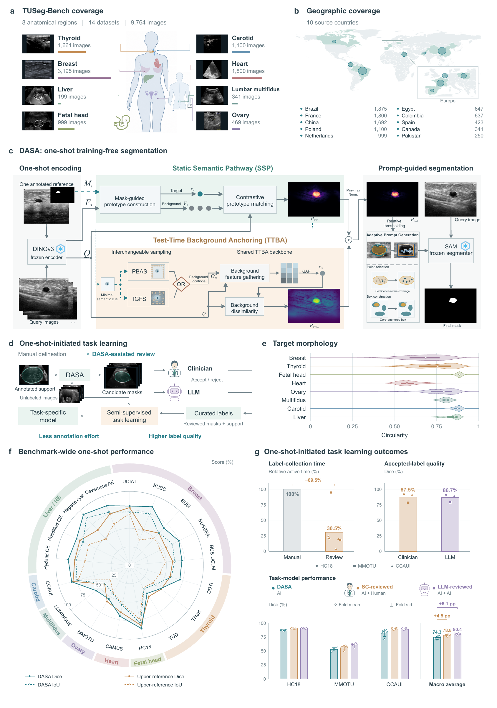

# DASA

**Training-free ultrasound segmentation for one-shot-initiated task learning**

DASA combines reference-guided semantic matching with test-time background
anchoring for ultrasound segmentation from a single annotated reference.
It uses frozen DINOv3 and SAM without parameter updates.

One-shot-initiated task learning (OITL) uses reviewed DASA masks to train
task-specific segmentation models.

## License

The core implementation is [Apache-2.0](LICENSE-CODE). Previously released
repository material retains its [MIT license](LICENSE); bundled SAM retains its
[original license](third_party/segment_anything/LICENSE).

Contact: chenfang_bme@163.com
